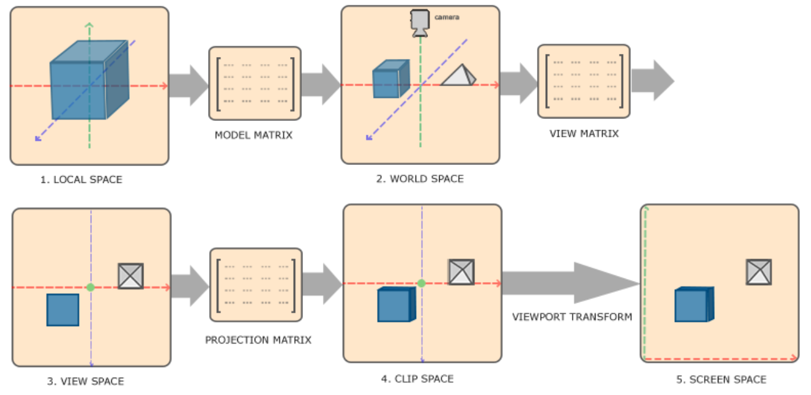
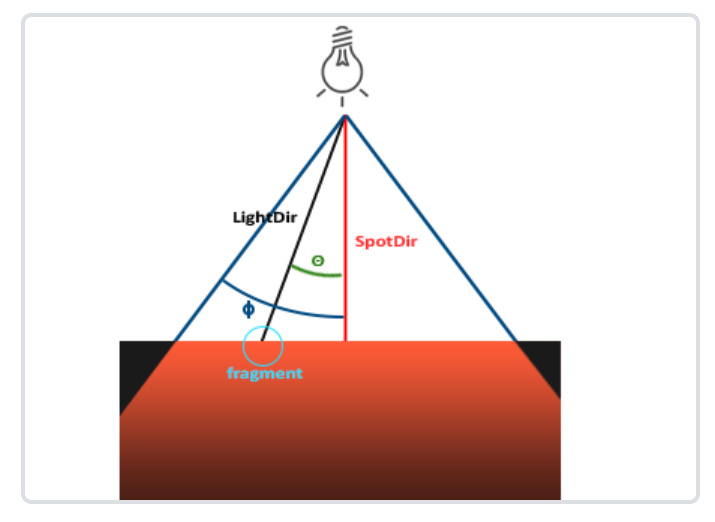
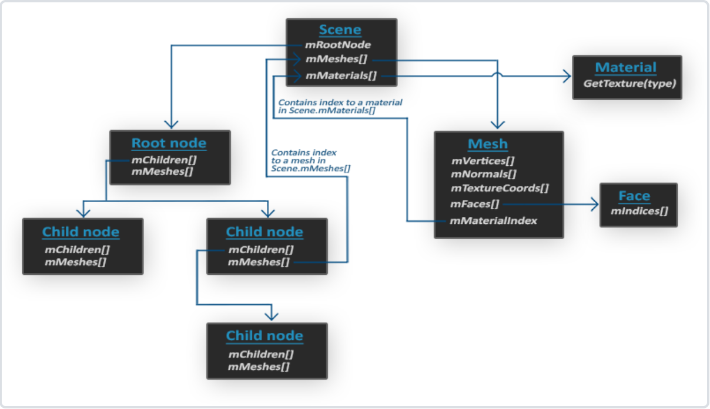

# 三维空间物体变换

齐次坐标:

$$
    P = \begin{bmatrix} x \\ y \\ z \\ w \end{bmatrix}
$$

- w 控制平移向量的影响，w = 0：与平移无关; w = 1：完全受平移向量影响; w = (0, 1): 透视投影的中间状态，实现近大远小
- 将原本平移操作的加法转换成乘法，多次的 三维变换可以组合成一次变换，比如：经历 T1->S1->T2 三次变换，可以先算出T 

缩放矩阵 S :

$$
S = \begin{bmatrix} S1 & 0 & 0 & 0 \\ 0 & S2 & 0 & 0 \\ 0 & 0 & S3 & 0 \\ 0 & 0 & 0 & 1 \end{bmatrix} * \begin{bmatrix} x \\ y \\ z \\ 1 \end{bmatrix} = \begin{bmatrix}  S1*x \\ S2*y \\ S3*z \\1 \end{bmatrix}
$$

- 缩放系数：S1、S2、S3

旋转矩阵 R :

1. 根据Local 坐标轴在 World坐标系的的三个方向向量为： xaxis、 yaxis、 zaxis, 则 $R_{wl}$(Local->World)、 $R_{lw}$(World->Local) 如下:
$$ 
    R_{wl} = \begin{bmatrix}  xaxis & yaxis & zaxis \end{bmatrix} = \begin{bmatrix} xaxis.x & yaxis.x & zaxis.x \\ xaxis.y & yaxis.y & zaxis.y \\ xaxis.z & yaxis.z & zaxis.z \end{bmatrix} 
$$ 

$$
    R_{lw} = \begin{bmatrix}  xaxis^T & yaxis^T & zaxis^T \end{bmatrix} = \begin{bmatrix} xaxis.x & xaxis.y & xaxis.z \\ yaxis.x & yaxis.y & yaxis.z \\ zaxis.x & zaxis.y & zaxis.z\end{bmatrix} 
$$

2. 三维旋转可以分为内旋(绕运动轴)和外旋(绕固定轴)，通用的旋转变换解读如下所示：

 $$ P_{world}=R_z*R_y*R_x*P_{local} $$

 - World坐标系与Local坐标系重合，Local坐标系下点p 绕固定轴(World坐标轴)依次旋转Rx、Ry、 Rz， 最终点P是在world坐标系的位置。
 - World坐标系与Local坐标系重合，Local坐标系的点p 绕运动轴(Local坐标轴)旋转Rz, 再以旋转后的坐标系旋转Ry, 再以旋转之后的坐标系旋转Rx，最终点P是在world坐标系的位置。
 - 点 P 在 Local 坐标系下保持不动，local坐标轴绕运动轴依次旋转 -Rx，-Ry，-Rz， 此时local坐标轴与world坐标轴重合。 
 - 点 P 在 World 坐标系下保持不动，world坐标轴绕运动轴依次旋转 Rz，Ry， Rx， 此时world坐标轴与local坐标轴重合。


平移向量 t ：

1. 根据Local 坐标轴原点在 World坐标系的位置 P, 可以推出如下关系：

- 在 World 坐标系下，Local到World的平移向量为: $ t_{wl} = \begin{bmatrix} p_x \\ p_y \\ p_z \end{bmatrix} $，变换关系：$
P_w = R_{wl}*P_l + t_{wl} $, ---- 先旋转，再平移
- 在 World 坐标系下，World 到 Local的平移向量为: $ t_{lw} = \begin{bmatrix} -p_x \\ -p_y \\ -p_z \end{bmatrix} $，变换关系：$
P_l = R_{lw}*(P_w + t_{lw})$ ---- 先平移, 再旋转
- 在 Local 坐标系下，World 到 Local的平移向量为：$ t_{lw} = R_{lw}*\begin{bmatrix} -p_x \\ -p_y \\ -p_z \end{bmatrix} $，变换关系: $ P_l = R_{lw} * P_w + t_{lw} $ ---- 先旋转, 再平移
- 在 Local 坐标系下, Local到World的平移向量为: $ t_{wl} = R_{lw}*\begin{bmatrix} p_x \\ p_y \\ p_z \end{bmatrix} $, 变换关系: $  P_w = R_{wl}* (P_l + t_{wl})$ ---- 先平移，再旋转

LookAt矩阵:

```
// Position: View位于 Model 坐标系的位置 
// Front: Model坐标系下，View 观测的方向向量 
// Up: Model坐标系下的上方向向量
// return: 从Model -> View的变换矩阵
calculate_lookAt_matrix2(Position, Position + Front, Up);


// OpenGL 坐标系：右上后， 观测方向是: -Z
glm::mat4 calculate_lookAt_matrix2(glm::vec3 position, glm::vec3 target, glm::vec3 worldUp){
    // View 坐标轴向量
    glm::vec3 zaxis = glm::normalize(position - target);                            // 后
    glm::vec3 xaxis = glm::normalize(glm::cross(glm::normalize(worldUp), zaxis));   // 右
    glm::vec3 yaxis = glm::cross(zaxis, xaxis);                                     // 上
    
    // Model -> View 的旋转矩阵
    glm::mat4 rotation = glm::mat4(1.0f);
    rotation[0][0] = xaxis.x; // 第一行: xaxis
    rotation[1][0] = xaxis.y;
    rotation[2][0] = xaxis.z;
    rotation[0][1] = yaxis.x; // 第二行: yaxis
    rotation[1][1] = yaxis.y;
    rotation[2][1] = yaxis.z;
    rotation[0][2] = zaxis.x; // 第三行: zaxis
    rotation[1][2] = zaxis.y;
    rotation[2][2] = zaxis.z;

    // Model 坐标系下，Model -> View 的平移向量
    glm::mat4 translation = glm::mat4(1.0f);
    translation[3][0] = -position.x;
    translation[3][1] = -position.y;
    translation[3][2] = -position.z;
    
    glm::mat4 trans = rotation * translation;   // 先平移再旋转
    return trans;
}
```

欧拉角:

```
/*
    定义欧拉角的旋转顺序，先Pitch 再 Yaw

        初始世界坐标系: 右上后
        初始pitch : 0
        初始yaw: -pi / 2 (坐标轴正方向旋转pi / 2)

        Position坐标系: 前上右
*/
void updateCameraVectors() {
    // 欧拉角旋转顺序：Pitch -> Yaw
    glm::vec3 front;
    front.x = cos(glm::radians(Yaw))* cos(glm::radians(Pitch));
    front.y = sin(glm::radians(Pitch));
    front.z = sin(glm::radians(Yaw))*cos(glm::radians(Pitch));
    Front = glm::normalize(front);
    
    // 向量叉乘的方向按照右手定则确定方向
    Right = glm::normalize(glm::cross(Front, WorldUp));
    //Up = glm::normalize(glm::cross(Front, Right));
    Up = glm::normalize(glm::cross(Right, Front));
}
```

# 搭建开发环境

GLFW 下载地址: https://www.glfw.org/download.html  
GLAD 下载地址: https://glad.dav1d.de/
- Language: c/c++
- Specification: OpenGL
- API: 
- - gl: Version 3.3
- Profile: Core
- Options
- - Generate a loader

点击 GENERATE 生成 GLAD 头文件和源码。 将GLFW 和 GLAD 头文件、库文件、源码添加到工程后，编译，链接后，运行测试成功。

# OpenGL 入门

OpenGL 坐标轴: 右上后  
纹理坐标系: 纹理图片的左下点 (由于 stbi_load 默认加载的图片垂直方向会翻转，导致纹理坐标可以按照左上点的坐标系来输入)  

## 坐标系统

OpenGL希望在每次顶点着色器运行后, 所有顶点都为标准化设备坐标(NDC)。也就是说坐标要在(-1, 1)之间，超过这个范围的坐标将会不可见。在转换成标准化设备坐标前还有多个空间系统的转换，其中比较重要的坐标系统如下：

- 局部空间(Local Space) 或 物体空间(Object Space) (右手坐标系-右上后)
- 全局空间(World Space)
- 相机空间(View Space)
- 裁剪空间(Clip Space)
- 屏幕空间(Screen Space)

坐标变换的Pipeline:

1. 顶点输入的坐标是在局部空间，这个坐标可以是任意范围。
2. 局部坐标经过 Model 可以转换到全局坐标。
3. 世界坐标经过 View 可以转到到相机所在的坐标。
4. 相机坐标经过 投影变换(正射投影、透视投影) 可以转到裁剪坐标，裁剪坐标在(-1, 1)范围会被显示到屏幕上
5. 裁剪坐标(-1, 1)范围内的坐标，经过视口变换到由glViewport函数所定义的坐标范围内，经过光栅器转换成片段。

 

## 参考代码

```

#include <iostream>

#include "camera.h"
#include "shader.h"
#include "stb_image.h"

#include "glad/glad.h"
#include <GLFW/glfw3.h>

#include <glm/glm.hpp>
#include <glm/gtc/matrix_transform.hpp>
#include <glm/gtc/type_ptr.hpp>
#include <glm/gtx/string_cast.hpp>

void frame_buffer_callback(GLFWwindow* window, int width, int height);
void mouse_callback(GLFWwindow* window, double xpos, double ypos);
void scroll_callback(GLFWwindow* window, double xoffset, double yoffset);
void process_input(GLFWwindow*window);

unsigned int loadTexture(const char* file_path);
unsigned int CreateVAO();

uint32_t SCR_WIDTH = 800;
uint32_t SCR_HEIGHT = 600;

float currentFrame = 0.0f;
float lastFrame = 0.0f;
float deltaTime = 0.0f;

float lastX = SCR_WIDTH / 2;
float lastY = SCR_HEIGHT / 2;
bool firstMouse = true;

Camera camera(glm::vec3(0.0f, 0.0f, 3.0f));

int main() {
	std::cout << "Hello World: depth_test" << std::endl;

	glfwInit();
	glfwWindowHint(GLFW_CONTEXT_VERSION_MAJOR, 3);
	glfwWindowHint(GLFW_CONTEXT_VERSION_MINOR, 3);
	glfwWindowHint(GLFW_OPENGL_PROFILE, GLFW_OPENGL_CORE_PROFILE);

	GLFWwindow* window = glfwCreateWindow(SCR_WIDTH, SCR_HEIGHT, "depth_test", NULL, NULL);
	if (window == NULL) {
		std::cout << "Failed to create GLFW window" << std::endl;
		glfwTerminate();
		return -1;
	}
	glfwMakeContextCurrent(window);	
	glfwSetFramebufferSizeCallback(window, frame_buffer_callback);
	glfwSetCursorPosCallback(window, mouse_callback);
	glfwSetScrollCallback(window, scroll_callback);
	glfwSetInputMode(window, GLFW_CURSOR, GLFW_CURSOR_DISABLED);

	if (!gladLoadGLLoader((GLADloadproc)glfwGetProcAddress)) {
		std::cout << "Failed to initialize GLAD" << std::endl;
		return -1;
	}

	glEnable(GL_DEPTH_TEST);
	
	unsigned int VAO = CreateVAO();
	//unsigned int textureId = loadTexture("resource/textures/awesomeface.png");
	unsigned int textureId = loadTexture("resource/textures/metal.png");

	Shader shader("depth_test.vs", "depth_test.fs");
	shader.use();
	shader.setInt("Texture0", 0);

	glm::vec3 tArray[] = {
		glm::vec3(-1.0f,  1.0f,  0.0f),
		glm::vec3(0.0f,   1.0f,  0.0f),
		glm::vec3(1.0f,   1.0f,  0.0f),

		glm::vec3(-1.0f,  0.0f,  0.0f),
		glm::vec3(0.0f,   0.0f,  0.0f),
		glm::vec3(1.0f,   0.0f,  0.0f),

		glm::vec3(-1.0f,  -1.0f,  0.0f),
		glm::vec3(0.0f,   -1.0f,  0.0f),
		glm::vec3(1.0f,   -1.0f,  0.0f)
	};
	
	while (!glfwWindowShouldClose(window)) {
		currentFrame = glfwGetTime();
		deltaTime = currentFrame - lastFrame;
		lastFrame = currentFrame;
		
		process_input(window);

		glClearColor(0.2f, 0.3f, 0.3f, 1.0f);
		glClear(GL_COLOR_BUFFER_BIT | GL_DEPTH_BUFFER_BIT);
	
		for (int i = 0; i < 9; i++) {
			glBindVertexArray(VAO);

			glActiveTexture(GL_TEXTURE0);
			glBindTexture(GL_TEXTURE_2D, textureId);

			glm::mat4 model = glm::mat4(1.0f);

			model = glm::translate(model, tArray[i]);

			shader.setMat4("model", model);

			glm::mat4 view = camera.GetViewMatrix();

			shader.setMat4("view", view);

			glm::mat4 projection = glm::perspective(glm::radians(camera.GetZoom()), (float)SCR_WIDTH / (float)SCR_HEIGHT, 0.1f, 100.0f);
			shader.setMat4("projection", projection);

			glDrawArrays(GL_TRIANGLES, 0, 6);
		}
		glfwSwapBuffers(window);
		glfwPollEvents();
	}

	return 0;
}

void frame_buffer_callback(GLFWwindow* window, int width, int height) {
	glViewport(0, 0, width, height);
}

void mouse_callback(GLFWwindow* window, double xposIn, double yposIn) {
	float xpos = static_cast<float>(xposIn);
	float ypos = static_cast<float>(yposIn);

	if (firstMouse) {
		lastX = xpos;
		lastY = ypos;
		firstMouse = false;
	}
	
	float xoffset = xpos - lastX;
	float yoffset = lastY - ypos;

	lastX = xpos;
	lastY = ypos;
	
	camera.ProcessMouseMovement(xoffset, yoffset);
}

void scroll_callback(GLFWwindow* window, double xoffset, double yoffset) {
	camera.ProcessMouseScroll(yoffset);
}

void process_input(GLFWwindow* window) {
	if (glfwGetKey(window, GLFW_KEY_ESCAPE) == GLFW_PRESS) {
		glfwSetWindowShouldClose(window, true);
		std::cout << "Close Window..." << std::endl;
		return;
	}
	if (glfwGetKey(window, GLFW_KEY_W) == GLFW_PRESS) {
		camera.ProcessKeyboard(CameraMovement::FORWARD, deltaTime);
	}
	if (glfwGetKey(window, GLFW_KEY_S) == GLFW_PRESS) {
		camera.ProcessKeyboard(CameraMovement::BACKWARD, deltaTime);
	}
	if (glfwGetKey(window, GLFW_KEY_A) == GLFW_PRESS) {
		camera.ProcessKeyboard(CameraMovement::LEFT, deltaTime);
	}
	if (glfwGetKey(window, GLFW_KEY_D) == GLFW_PRESS) {
		camera.ProcessKeyboard(CameraMovement::RIGHT, deltaTime);
	}
}

unsigned int CreateVAO() {
	float vertices[] = {
		// positions          // normals           // texture coords
		//-0.5f, 0.5f, -0.5f,  0.0f,  1.0f, 0.0f,   0.0f,  0.0f,
		//-0.5f, 0.5f, 0.5f,   0.0f,  1.0f, 0.0f,   0.0f,  1.0f,
		//0.5f, 0.5f, -0.5f,   0.0f,  1.0f, 0.0f,   1.0f,  0.0f,
		//-0.5f, 0.5f, 0.5f,   0.0f,  1.0f, 0.0f,  0.0f,  1.0f,
		//0.5f, 0.5f, 0.5f,    0.0f,  1.0f, 0.0f,   1.0f,  1.0f,
		//0.5f, 0.5f, -0.5f,   0.0f,  1.0f, 0.0f,   1.0f,  0.0f,

		-0.5f, 0.5f, 0.5f,  0.0f, 0.0f,		1.0,   0.0f,  0.0f,
		-0.5f, -0.5f, 0.5f, 0.0f, 0.0f,		1.0,  0.0f,  1.0f,
		0.5f, 0.5f, 0.5f,   0.0f,  0.0f,	1.0f, 1.0f,  0.0f,
		-0.5f, -0.5f, 0.5f, 0.0f, 0.0f,		1.0,  0.0f,  1.0f,
		0.5f, -0.5f, 0.5f,  0.0f, 0.0f,		1.0,   1.0f,  1.0f,
		0.5f, 0.5f, 0.5f,   0.0f,  0.0f,	1.0f, 1.0f,  0.0f
	};

	unsigned int VAO, VBO;
	
	glGenVertexArrays(1, &VAO);
	glGenBuffers(1, &VBO);

	glBindVertexArray(VAO);
	glBindBuffer(GL_ARRAY_BUFFER, VBO);
	glBufferData(GL_ARRAY_BUFFER, sizeof(vertices), vertices, GL_STATIC_DRAW);

	glEnableVertexAttribArray(0);
	glVertexAttribPointer(0, 3, GL_FLOAT, GL_FALSE, 8 * sizeof(float), (void*)0);

	glEnableVertexAttribArray(1);
	glVertexAttribPointer(1, 3, GL_FLOAT, GL_FALSE, 8 * sizeof(float), (void*)(3 * sizeof(float)));
	
	glEnableVertexAttribArray(2);
	glVertexAttribPointer(2, 2, GL_FLOAT, GL_FALSE, 8 * sizeof(float), (void*)(6 * sizeof(float)));
	
	glBindVertexArray(0);
	return VAO;
}

unsigned int loadTexture(const char* file_path) {
	unsigned int textureID;
	glGenTextures(1, &textureID);
	int width, height, nrChannels;

	unsigned char* data = stbi_load(file_path, &width, &height, &nrChannels, 0);
	if (data) {
		GLenum format;
		if (nrChannels == 1)
			format = GL_RED;
		else if (nrChannels == 3)
			format = GL_RGB;
		else if (nrChannels == 4)
			format = GL_RGBA;
		glBindTexture(GL_TEXTURE_2D, textureID);
		glTexImage2D(GL_TEXTURE_2D, 0, format, width, height, 0, format, GL_UNSIGNED_BYTE, data);
		glGenerateMipmap(GL_TEXTURE_2D);
		glTexParameteri(GL_TEXTURE_2D, GL_TEXTURE_WRAP_S, GL_REPEAT);
		glTexParameteri(GL_TEXTURE_2D, GL_TEXTURE_WRAP_T, GL_REPEAT);
		glTexParameteri(GL_TEXTURE_2D, GL_TEXTURE_MIN_FILTER, GL_LINEAR_MIPMAP_LINEAR);
		glTexParameteri(GL_TEXTURE_2D, GL_TEXTURE_MAG_FILTER, GL_LINEAR);
		stbi_image_free(data);
	}
	else {
		std::cout << "Failed to load texture: " << file_path << std::endl;
		stbi_image_free(data);
	}
	return textureID;
}

```

# 基础光照

## 风氏光照模型

- 环境光照(Ambient Lighting)：一般使用环境光照常量，它永远会给物体一些颜色。
- 漫反射光照(Defuse Lighting): 物体某一部分正对着光，他就越亮。核心代码如下：
- 镜面光照(Specular Lighting): 模拟光泽物体上面出现的亮点，他比物体的颜色更倾向于光照的颜色。 核心代码如下：

风氏光照模型总体参考代码如下：

```
// cpp 法线矩阵：根据模型矩阵计算法线矩阵 
glm::mat3 normalMatrix = glm::mat3(transpose(inverse(model)));
cubeShader.setMat3("normalMatrix", normalMatrix);
```

``` cube.vs
// 顶点着色器中计算顶点的法向量， 输入法向量需要乘以法线矩阵
Normal = normalMatrix * aNormal;
FragPos = vec3(model * vec4(aPos, 1.0));
```

``` cube.fs
struct Material {
    // sampler2D diffuse;  // 光照贴图，环境光和满反射贴图是一样的
    // sampler2D specular; // 镜面光照贴图

    vec3 ambient;		// 此材质在环境光照时的颜色(环境光下反射率)
    vec3 diffuse;		// 此材质在漫反射光照时的颜色(漫反射率)， 
    vec3 specular;		// 此材质在镜面反射光照时的颜色(镜面反射率)

    float shininess;	// 此材质在镜面光照时的反射度
}; 

uniform Material material;

struct Light {
    vec3 position;		// 光源的位置

    vec3 ambient;		// 光源的环境光照强度，一般设置数值较低，不希望环境光太主导 (0.2f, 0.2f, 0.2f)
    vec3 diffuse;		// 光源的漫反射光照强度，一般设置希望光照强度 (0.5f, 0.5f, 0.5f)
    vec3 specular;		// 光源的镜面反射光照强度, 通常使用最大强度发光 vec3(1.0f)
};

uniform Light light;

uniform vec3 viewPos;

void main() {    
    // 环境光照
    vec3 ambient = light.ambient * material.ambient;

    // 漫反射光照
    vec3 lightDir = normalize(light.position - FragPos);
    vec3 Normal = normalize(Normal);
    float diff = max(dot(Normal, lightDir), 0.0);
    vec3 diffuse = diff * light.diffuse * material.diffuse;
    
    // 漫反射光照贴图
    // vec3 diffuse = diff * light.diffuse * vec3(texture(material.diffuse, TexCoords));
    
    // 镜面光照
    vec3 viewDir = normalize(viewPos - FragPos);
    vec3 reflectDir = reflect(-lightDir, Normal); // 第一个参数是光源的反方向

    float spec = pow(max(dot(viewDir, reflectDir), 0.0), material.shininess); // material.shininess 表示高光的反射度
    vec3 specular = spec * light.specular * material.specular;

    // 镜面反射光照贴图
    // vec3 specular = spec * light.specular * vec3(texture(material.specular, TexCoords));

    // 风氏光照模型
    vec3 phong = ambient + diffuse + specular;
    FragColor = vec4(phong, 1.0);
}

```

## 多光源

- 定向光源：所有光线是同一个方向的平行光
- 点光源: 光源处于一个固定的位置，且随着距离的变化进行衰减
- 聚光光源: 聚光光源使用位置 + 方向 + 切光角表示，

点光源的衰减系数先随着距离的增大，光照强度衰减的越来越快；到达某一个阈值后，衰减系数随着距离的增大，光照强度的刷件越来越慢。
$$
	F_{att} = \frac {1.0} {K_c + K_l * d + K_q * d^2}
$$

- $ F_{att} $: 光源的衰减系数
- $K_c$: 常数项通常为1.0, 它保证衰减系数在(0, 1)之间。
- $K_l$: 一次项衰减系数
- $K_q$: 二次项衰减系数

常用的点光源衰减系数设置参考: https://wiki.ogre3d.org/tiki-index.php?page=-Point+Light+Attenuation



- LightDir: 从片段指向光源的向量
- SpotDir: 聚光所指向的方向
- $\phi$: 指定聚光半径的切光角
- $\theta$: LightDir和 SpotDir 向量的夹角

使用内圆锥与外圆锥模拟聚光效果，上面的切光角可以看做是内光锥的半径。内光锥和外光锥之间的部分使用插值计算

$$
    I = \frac { \theta - \gamma } { \epsilon }
$$

- $ I $: 当前片段的聚光强度
- $ \theta $: 片段到光心的方向向量与聚光方向的余弦值
- $ \gamma $: 外光切角的余弦值
- $ \epsilon $: 内外光切角余弦值的差($\phi$ 与 $\gamma$)

计算举例：

| $ \theta $ | $ \theta $(角度) | $\phi$(内切光角) | $\phi$(角度) | $\gamma$ (外切光角)  | $\gamma$(角度) | $ \epsilon$ | $I$ | 
|------|------|------|------|------|------|------|------|
| 0.87 |  30  | 0.91 | 25   | 0.82 |  35  | 0.91 - 0.82 = 0.09 | 0.87 - 0.82 / 0.09 = 0.56|
| 0.9 | 26	|0.91 |25 |	0.82 | 35 | 0.91 - 0.82 = 0.09 | 0.9 - 0.82 / 0.09 = 0.89 |


多光源参考代码如下：

```
struct Material {
	sampler2D diffuse;
	sampler2D specular;
	float shininess;
};

struct DirLight {
	vec3 direction; // 光照方向(光心往外)

	vec3 ambient;
	vec3 diffuse;
	vec3 specular;
};

struct PointLight {
	vec3 position;

	float constant;
	float linear;
	float quadratic;
	
	vec3 ambient;
	vec3 diffuse;
	vec3 specular;
};

struct SpotLight {
	vec3 position;
	vec3 direction;
	float cutOff;
	float outerCutOff;

	float constant;
	float linear;
	float quadratic;

	vec3 ambient;
	vec3 diffuse;
	vec3 specular;
};

// 定向光源
vec3 CalcDirLight(DirLight light, vec3 normal, vec3 viewDir) {
    vec3 lightDir = normalize(-light.direction);

	vec3 ambient = light.ambient * vec3(texture(material.diffuse, TexCoords));

    float diff = max(dot(normal, lightDir), 0.0);
    vec3 diffuse = light.diffuse * diff * vec3(texture(material.diffuse, TexCoords));

    vec3 reflectDir = reflect(-lightDir, normal);
    float spec = pow(max(dot(viewDir, refl ectDir), 0.0), material.shininess);
    vec3 specular = light.specular * spec * vec3(texture(material.specular, TexCoords));

    return (ambient + diffuse + specular);
}

// 点光源
vec3 CalcPointLight(PointLight light, vec3 normal, vec3 fragPos, vec3 viewDir) {
	vec3 lightDir = normalize(light.position - fragPos);

    vec3 ambient = light.ambient * vec3(texture(material.diffuse, TexCoords));

	float diff = max(dot(lightDir, normal), 0.0);
	vec3 diffuse = light.diffuse * diff * vec3(texture(material.diffuse, TexCoords));
	
	float spec = pow(max(dot(viewDir, reflect(-lightDir, normal)), 0.0), material.shininess);
	vec3 specular = light.specular * spec * vec3(texture(material.specular, TexCoords));

	// 计算光源距离衰减系数
	float distance = length(light.position - fragPos);
	float attenuation = 1.0 / (light.constant + light.linear * distance + light.quadratic * distance * distance);
	
	ambient *= attenuation;
    diffuse *= attenuation;
	specular *= attenuation;

	return (ambient + diffuse + specular);	
}

// 聚光光源
vec3 CalcSpotLight(SpotLight light, vec3 normal, vec3 fragPos, vec3 viewDir) {
	vec3 lightDir = normalize(light.position - fragPos);

	vec3 ambient = light.ambient * vec3(texture(material.diffuse, TexCoords));

	float diff = max(dot(lightDir, normal), 0.0);
	vec3 diffuse = light.diffuse * diff * vec3(texture(material.diffuse, TexCoords));

	float spec = pow(max(dot(viewDir, reflect(-lightDir, normal)), 0.0), material.shininess);
	vec3 specular = light.specular * spec * vec3(texture(material.specular, TexCoords));

	// 计算光源距离衰减系数
	float distance = length(light.position - fragPos);
    float attenuation = 1.0 / (light.constant + light.linear * distance + light.quadratic * (distance * distance));
	
	// 计算聚光衰减
    float theta = dot(lightDir, normalize(-light.direction));

	float epsilon = light.cutOff - light.outerCutOff;
    float intensity = clamp((theta - light.outerCutOff) / epsilon, 0.0, 1.0);

	ambient *= attenuation * intensity;
	diffuse *= attenuation * intensity;
	specular *= attenuation * intensity;

	return (ambient + diffuse + specular);
}

```

# Assimp 模型加载



``` mesh.h
struct Vertex {
	glm::vec3 position;
	glm::vec3 normal;
	glm::vec2 texCoords;
};

struct Texture {
	unsigned int id;
	std::string type;
	std::string path;
};

class Mesh {
public:
	std::vector<Vertex> vertices;
	std::vector<unsigned int> indices;
	std::vector<Texture> textures;

	Mesh(const std::vector<Vertex>& verticesIn, const std::vector<unsigned int>& indicesIn, const std::vector<Texture>& texturesIn) 
		: vertices(verticesIn), indices(indicesIn), textures(texturesIn) {
		setupMesh();
	}
	virtual ~Mesh() {}

	void draw(Shader& shader) { .... }
    void setupMesh() { ... }
private:
	unsigned int VAO;
	unsigned int VBO;
	unsigned int EBO;
}
```

``` model.h
class Model {
public:
	std::vector<Mesh> meshes;
	std::vector<Texture> textures_loaded;
	
	std::string directory;

	Model(const std::string& path) {
		directory = path.substr(0, path.find_last_of('/'));

		loadModel(path);
	}
	virtual ~Model() {}

	void draw(Shader& shader) {
		for (unsigned int i = 0; i < meshes.size(); i++)
			meshes[i].draw(shader);
	}
private:
    void loadModel(const std::string& path) { ... }
}
```

# 高级OpenGL

## 深度测试

深度测试默认会在片段着色器之后，当开启深度测试后，会根据投影模型计算深度z-order(gl_FragCoord.z), 通过深度测试(默认z-order最小)的像素可以显示出来。

深度测试精度(24bit):

$$
    F_{depth} = \frac {1/z - 1/near} {1/far - 1/near}
$$

深度精度并不是线性的，随着 Z 值越小，深度精度越大；Z 值越大，深度精度越小。

深度冲突:

1. 不要把多个物体摆放的太近，可以考虑设置一个小的偏移值。
2. 尽可能的将近平面靠近物体，由于近平面精度较高，可以避免深度冲突。
3. 使用更高精度的深度缓冲，一般情况下的深度缓冲是24bit, 但大部分显卡都可以支持32bit的深度缓冲，但是会牺牲性能。

深度测试相关函数：

```
glEnable(GL_DEPTH_TEST);                            // 开启深度测试
glClear(GL_COLOR_BUFFER_BIT | GL_DEPTH_BUFFER_BIT); // 清除深度缓存
glDepthMask(GL_FALSE);                              // 禁止改写深度缓存

glDepthFunc(GL_LESS);                               // 深度测试函数：GL_LESS：深度测试 选 z 最小的
```

## 模板测试

模板测试在 片段着色器之后，深度测试之前。当开启模板测试后，显示屏幕的像素会根据模板缓冲区的内容来决定是否显示到屏幕，通常模板测试是用来高亮指定物体，比如: 渲染指定物体前，设置模板缓冲区的逻辑为直接写入，写入完成后，将原物体放大再重新写入，重新写入时会根据模板缓冲区的数据原始物体不写入，放大的部分使用指定着色器高亮渲染。

模板缓冲区的有效精度是8bit(0 - 255)。

高亮选中物体代码如下：

```
glEnable(GL_STENCIL_TEST);					// 开启模板测试
glStencilOp(GL_KEEP, GL_KEEP, GL_REPLACE);	// 模板测试不通过-保持原状; 深度测试不通过-保持原状; 模板和深度测试都通过-更新缓冲区
glStencilFunc(GL_NOTEQUAL, 1, 0xFF);		// 只要不等于 1，就会通过测试
....

// 循环渲染
{
	glClear(GL_COLOR_BUFFER_BIT | GL_DEPTH_BUFFER_BIT | GL_STENCIL_BUFFER_BIT);	// 清除模板缓冲区

	glStencilMask(0x00);					// 禁止更新模板缓冲区

	... // 画其他物体，比如: 地面

	glStencilFunc(GL_ALWAYS, 1, 0xFF); 		// 所有写入都通过模板测试, 通过模板测试写入 1
	glStencilMask(0xFF);					// 开启更新模板缓冲区

	... // 画指定物体，指定物体区域会更新到模板缓冲区中

	glStencilFunc(GL_NOTEQUAL, 1, 0xFF);	// 模板缓冲区的数据不等于1，就可以通过模板测试
	glStencilMask(0x00); 					// 禁止更新模板缓冲区
	glDisable(GL_DEPTH_TEST);				// 关闭深度测试
	
	... // 将指定物体放大后，使用高亮的Shader重绘; 
	    // 深度缓冲区记录了物体的位置， glStencilFunc(GL_NOTEQUAL, 1, 0xFF); 会让物体的位置不再重绘，只是高亮放大的轮廓

	glStencilMask(0xFF);					// 开启更新模板缓冲区
	glStencilFunc(GL_ALWAYS, 0, 0xFF);		// 所有写入都通过模板测试, 通过模板测试写入 0
	glEnable(GL_DEPTH_TEST);				// 开启深度测试
}
```

## 混合(Blending)

混合是根据Alpha值的不同，对多个纹理进行混合渲染。

丢弃片段: 片段着色器中当片段的透明值小于阈值后，不渲染此片段
``` transparent.fs
void main() {             
    vec4 texColor = texture(texture1, TexCoords);
    if(texColor.a < 0.1)
        discard;
    FragColor = texColor;
}
```

!! 由于纹理插值问题，可能会形成一个有色的变宽，可以使用: glTexParameteri( GL_TEXTURE_2D, GL_TEXTURE_WRAP_S, GL_CLAMP_TO_EDGE);

混合渲染:

混合渲染会按照比率对当前片段(SRC)和历史片段(DST)的颜色，按照比例进行混合渲染。

```
glEnable(GL_BLEND): 开启混合渲染
glBlendFunc(GL_SRC_ALPHA, GL_ONE_MINUS_SRC_ALPHA): GL_SRC_ALPHA-> 使用当前渲染物体的alpha, GL_ONE_MINUS_SRC_ALPHA->已渲染的物体使用 1 - alpha
```

!! 混合渲染和深度测试的冲突:

深度测试时并不会检查片段是否是透明的，即即使片段是透明的但因为深度更小，会对后面的物体产生遮挡。优化方式如下：

- 对于完全透明的物体，考虑使用丢弃片段而不是混合渲染的方式(避免透明片段深度遮挡的问题)。
- 对于不完全透明的物体，渲染顺序如下： 
- - 渲染完全不透明的物体
- - 对所有透明的物体按照距离排序
- - 按照距离从远到近依次渲染物体(用来保证渲染的片段都可以通过深度测试)

## 面剔除

OpenGL 多边形顶点顺序默认使用逆时针的顺序，立方体背面的多边形在观测方向上顶点的顺序是顺时针，会被剔除掉。 面剔除可以优化性能，但是针对单个图片(草)一些场景不能启动面剔除(从背面观看时会被剔除掉)。

```
glEnable(GL_CULL_FACE); // 开启面剔除
glCullFace(GL_FRONT);	// GL_FRONT: 只剔除正面, GL_BACK:只剔除背面
glFrontFace(GL_CCW);	// GL_CCW：定义逆时针为正面 GL_CW：定义顺时针为正面
```

## 帧缓冲

帧缓冲包括颜色缓冲区(纹理)、 深度缓冲和模板缓冲。我们默认的渲染数据都是在屏幕缓冲，而帧缓冲的主要用于离屏渲染，可以针对同一个帧缓冲纹理做不同的后处理操作。

帧缓冲的用法：

```
// 创建帧缓存
void CreateFrameBuffer(int width, int height, unsigned int* framebufferOut, unsigned int* texturebufferOut) {
	unsigned int framebuffer;
	glGenFramebuffers(1, &framebuffer);
	glBindFramebuffer(GL_FRAMEBUFFER, framebuffer);

	// texture
	unsigned int texturebuffer;
	glGenTextures(1, &texturebuffer);
	glBindTexture(GL_TEXTURE_2D, texturebuffer);
	glTexImage2D(GL_TEXTURE_2D, 0, GL_RGB, width, height, 0, GL_RGB, GL_UNSIGNED_BYTE, NULL);
	glTexParameteri(GL_TEXTURE_2D, GL_TEXTURE_MIN_FILTER, GL_LINEAR);
	glTexParameteri(GL_TEXTURE_2D, GL_TEXTURE_MAG_FILTER, GL_LINEAR);
	glFramebufferTexture2D(GL_FRAMEBUFFER, GL_COLOR_ATTACHMENT0, GL_TEXTURE_2D, texturebuffer, 0);

	// rbo: 只需要深度测试
	unsigned int rbo;
	glGenRenderbuffers(1, &rbo);
	glBindRenderbuffer(GL_RENDERBUFFER, rbo);
	glRenderbufferStorage(GL_RENDERBUFFER, GL_DEPTH24_STENCIL8, width, height);
	glFramebufferRenderbuffer(GL_FRAMEBUFFER, GL_DEPTH_STENCIL_ATTACHMENT, GL_RENDERBUFFER, rbo);

	// check
	if (glCheckFramebufferStatus(GL_FRAMEBUFFER) != GL_FRAMEBUFFER_COMPLETE) {
		std::cout << "ERROR::FRAMEBUFFER:: Framebuffer is not complete!" << std::endl;
	}
	glBindFramebuffer(GL_FRAMEBUFFER, 0);

	*framebufferOut = framebuffer;
	*texturebufferOut = texturebuffer;
}

// 循环渲染
{ 
	// 1. 渲染到帧缓存
	glBindFramebuffer(GL_FRAMEBUFFER, framebuffer);
	glEnable(GL_DEPTH_TEST);

	glClearColor(0.1f, 0.1f, 0.1f, 1.0f);
	glClear(GL_COLOR_BUFFER_BIT | GL_DEPTH_BUFFER_BIT | GL_STENCIL_BUFFER_BIT);

	glm::mat4 projection = glm::perspective(glm::radians(camera.GetZoom()), (float)SCR_WIDTH / (float)SCR_HEIGHT, 0.1f, 100.0f);

	shader.use();
	shader.setInt("texture1", 0);
	shader.setMat4("model", glm::mat4(1.0f));
	shader.setMat4("view", camera.GetViewMatrix());
	shader.setMat4("projection", projection);

	glBindVertexArray(planeVAO);
	glActiveTexture(GL_TEXTURE0);
	glBindTexture(GL_TEXTURE_2D, floorTexture);
	glDrawArrays(GL_TRIANGLE_STRIP, 0, 6);

	glBindVertexArray(cubeVAO);
	glActiveTexture(GL_TEXTURE0);
	glBindTexture(GL_TEXTURE_2D, cubeTexture);
	glDrawArrays(GL_TRIANGLES, 0, 36);

	// 2. 将帧缓冲的纹理渲染到屏幕缓冲
	glBindFramebuffer(GL_FRAMEBUFFER, 0);  	// 使用屏幕缓冲
	glDisable(GL_DEPTH_TEST);				// 关闭深度测试

	glClearColor(1.0f, 1.0f, 1.0f, 1.0f); 
	glClear(GL_COLOR_BUFFER_BIT);

	screenShader.use();
	screenShader.setInt("screenTexture", 0);

	glBindVertexArray(quadVAO);
	glActiveTexture(GL_TEXTURE0);
	glBindTexture(GL_TEXTURE_2D, texturebuffer);	
	glDrawArrays(GL_TRIANGLES, 0, 6);

	....
}

```

后处理核函数:


模糊核: 累加和为1; 表示计算当前像素和其他周围像素的加权平均值;

$$
	\begin{bmatrix} 1 & 2 & 1 \\ 2 & 4& 2 \\ 1 & 2 & 1 \end{bmatrix} / 16
$$

边缘检测核: 累加和为0; 表示计算中心像素和四周8个像素的差值，中心区域差值小显示黑色(0),边缘区域(左黑右白)插值较大显示白色(非0)

$$
	\begin{bmatrix} 1 & 1 & 1 \\ 1 & -8 & 1 \\ 1 & 1 & 1\end{bmatrix}
$$

锐化核: 累加和为1; 表示原图 + 边缘检测取反(边缘增强)
$$
	\begin{bmatrix}  -1 & -1 & -1 \\ -1 & 9 & -1 \\ -1 & -1 & -1\end{bmatrix} = \begin{bmatrix} 0 & 0 & 0  \\ 0 & 1 & 0 \\ 0 & 0 & 0 \end{bmatrix} + \begin{bmatrix} -1 & -1 & -1 \\ -1 & 8 & -1 \\ -1 & -1 & -1\end{bmatrix}
$$


核函数卷积参考如下代码：
```
const float offset = 1.0 / 300.0;  

void main()
{
    vec2 offsets[9] = vec2[](
        vec2(-offset,  offset), // 左上
        vec2( 0.0f,    offset), // 正上
        vec2( offset,  offset), // 右上
        vec2(-offset,  0.0f),   // 左
        vec2( 0.0f,    0.0f),   // 中
        vec2( offset,  0.0f),   // 右
        vec2(-offset, -offset), // 左下
        vec2( 0.0f,   -offset), // 正下
        vec2( offset, -offset)  // 右下
    );

    float kernel[9] = float[](
        -1, -1, -1,
        -1,  9, -1,
        -1, -1, -1
    );

    vec3 sampleTex[9];
    for(int i = 0; i < 9; i++)
    {
        sampleTex[i] = vec3(texture(screenTexture, TexCoords.st + offsets[i]));
    }
    vec3 col = vec3(0.0);
    for(int i = 0; i < 9; i++)
        col += sampleTex[i] * kernel[i];

    FragColor = vec4(col, 1.0);
}

```

## 立方体贴图

立方体贴图是用6张2D纹理合并的一张立方体纹理。立方体贴图有一个有用的特性，可以针对一个方向进行纹理采样，这样当我们原点位于一个(-1, 1) 立方体的中心时，顶点纹理坐标等于顶点坐标就可以对整个立方体按照方向进行纹理采样。

天空盒参考如下:

``` skybox.vs
#version 330 core

layout (location = 0) in vec3 a_Position;

uniform mat4 u_View;
uniform mat4 u_Projection;

out vec3 v_TexCoord;

void main() {
    v_TexCoord = a_Position;	// 纹理坐标等于顶点坐标
    vec4 pos = u_Projection * u_View * vec4(a_Position, 1.0);
    gl_Position = pos.xyww;		// 天空盒的深度永远处于最大，只有前面没有任何遮挡才能通过深度测试
}
```

```
// 循环渲染:
{
	...
	glDepthFunc(GL_LEQUAL);

	skyboxShader.use();

	view = glm::mat4(glm::mat3(camera.GetViewMatrix())); // 天空盒不受平移向量的影响(相机不能靠近天空盒)

	skyboxShader.setMat4("u_View", view);
	skyboxShader.setMat4("u_Projection", projection);
	skyboxShader.setInt("u_Skybox", 0);

	glBindVertexArray(skyboxVAO);
	glActiveTexture(GL_TEXTURE0);
	glBindTexture(GL_TEXTURE_CUBE_MAP, cubemapTexture); // 绑定 GL_TEXTURE_CUBE_MAP 
	glDrawArrays(GL_TRIANGLES, 0, 36);
	glBindVertexArray(0);

	glDepthFunc(GL_LESS); // set depth function back to default
	.... 
}

// loads a cubemap texture from 6 individual texture faces
// order:
// +X (right)	: GL_TEXTURE_CUBE_MAP_POSITIVE_X
// -X (left)	: GL_TEXTURE_CUBE_MAP_NATIVE_X
// +Y (top)		: GL_TEXTURE_CUBE_MAP_POSITIVE_Y
// -Y (bottom)	: GL_TEXTURE_CUBE_MAP_NATIVE_Y
// +Z (front)	: GL_TEXTURE_CUBE_MAP_POSITIVE_Z
// -Z (back)	: GL_TEXTURE_CUBE_MAP_NATIVE_Z
// -------------------------------------------------------
unsigned int loadCubemap(std::vector<std::string> faces) {
	unsigned int textureID;
	glGenTextures(1, &textureID);
	glBindTexture(GL_TEXTURE_CUBE_MAP, textureID);

	for (int i = 0; i < faces.size(); i++) {
		int width, height, nrChannels;
		unsigned char* data = stbi_load(faces[i].c_str(), &width, &height, &nrChannels, 0);
		if (data) {
			GLenum format;
			if (nrChannels == 1)
				format = GL_RED;
			else if (nrChannels == 3)
				format = GL_RGB;
			else if (nrChannels == 4)
				format = GL_RGBA;

			glTexImage2D(GL_TEXTURE_CUBE_MAP_POSITIVE_X + i, 0, format, width, height, 0, format, GL_UNSIGNED_BYTE, data);
			stbi_image_free(data);
		}
		else {
			stbi_image_free(data);
		}
	}

	glTexParameteri(GL_TEXTURE_CUBE_MAP, GL_TEXTURE_MIN_FILTER, GL_LINEAR);
	glTexParameteri(GL_TEXTURE_CUBE_MAP, GL_TEXTURE_MAG_FILTER, GL_LINEAR);
	glTexParameteri(GL_TEXTURE_CUBE_MAP, GL_TEXTURE_WRAP_S, GL_CLAMP_TO_EDGE); // GL_CLAMP_TO_EDGE：超过纹理坐标的位置会显示边界值
	glTexParameteri(GL_TEXTURE_CUBE_MAP, GL_TEXTURE_WRAP_T, GL_CLAMP_TO_EDGE);
	glTexParameteri(GL_TEXTURE_CUBE_MAP, GL_TEXTURE_WRAP_R, GL_CLAMP_TO_EDGE);
	return textureID;
}

```

环境映射: 

将周围环境(skybox)映射到渲染物体上，根据物体材质可以分为：反射、折射。

``` cube.fs
#version 330 core

uniform samplerCube u_Skybox;
uniform vec3 u_CameraPos;

in vec2 v_TexCoord;
in vec3 v_Normal;
in vec3 v_Position;

out vec4 o_FragColor;

void main() {
	vec3 inputDir = normalize(v_Position - u_CameraPos);
	
	// 反射
	vec3 reflectDir = reflect(inputDir, normalize(v_Normal));
	
	// 折射
    float ratio = 1.0 / 1.52; // 折射率
	vec3 refractDir = refract(inputDir, normalize(v_Normal), ratio);

	o_FragColor = vec4(texture(u_Skybox, refractDir).rgb, 1.0);
}
```

动态环境映射：

## 高级数据

数据填充:

- glBufferData: 整块填充缓存
- glBufferSubData: 填充缓存指定区域
- glMapBuffer/glUnmapBuffer: 获取缓存地址
- glVertexAttribPointer: 设置顶点属性指针
- glCopyBufferSubData: 复制缓冲， GL_COPY_READ_BUFFER & GL_COPY_WRITE_BUFFER

函数说明：
```
// target: GL_ARRAY_BUFFER; size: 填充数据大小; data: 填充数据地址
void glBufferData(GLenum target, GLsizeiptr size, const void *data, GLenum usage);

// target: GL_ARRAY_BUFFER; offset: 偏移值; size: 填充数据大小; data: 填充数据地址
void glBufferSubData(GLenum target, GLintptr offset, GLsizeiptr size, const void *data);

// layout 
void glVertexAttribPointer(GLuint index, GLint size, GLenum type, GLboolean normalized, GLsizei stride, const void *pointer);
```

参考代码：
```
float data[] = {
  0.5f, 1.0f, -0.35f
  ...
};
glBindBuffer(GL_ARRAY_BUFFER, buffer);
// 获取指针
void *ptr = glMapBuffer(GL_ARRAY_BUFFER, GL_WRITE_ONLY);
// 复制数据到内存
memcpy(ptr, data, sizeof(data));
// 记得告诉OpenGL我们不再需要这个指针了
glUnmapBuffer(GL_ARRAY_BUFFER);
```

## 高级GLSL

GLSL内建变量： 

- gl_Position：顶点位置坐标
- gl_PointSize: 渲染点(像素)的宽高，需要配合 glEnable(GL_PROGRAM_POINT_SIZE); 使用。
- gl_VertexID: 正在渲染的顶点ID。 
- gl_FragColor: 片段着色器的颜色分量。
- gl_FragCoord: 只读变量 xy 分量是窗口坐标，坐标原点在左下角，z分量是对应片段的深度值。
- - 适用场景: 可以对窗口分屏显示不同的效果，对比效果
- gl_FrontFacing: bool 变量，判断当前片段是正面还是背面(不能启动面剔除)
- - 适用场景: 平面的正面和背面贴不同的纹理
- gl_FragDepth: 设置片段的深度值(gl_FragCoord 是只读变量，不能设置深度值) 
- gl_InstanceID: 实例化渲染的ID

接口块：

``` 顶点.vs
out VS_OUT {
    vec3 TexCoords;
} vs_out;

void main() {
    vs_out.TexCoords = a_Position;
	....
}
```

``` 片段.fs
in VS_OUT {
    vec3 TexCoords;
} fs_in;

out vec4 o_FragColor;

void main() {
    o_FragColor = texture(u_Skybox, fs_in.TexCoords);
}

```

UBO(uniform buffer object): 独立缓冲对象


```
unsigned int CreateUBO(const std::vector<Shader*>& shaders) {
	// 1.创建 ubo 缓存对象
	unsigned int ubo;
	glGenBuffers(1, &ubo);
	glBindBuffer(GL_UNIFORM_BUFFER, ubo);
	glBufferData(GL_UNIFORM_BUFFER, sizeof(glm::mat4) * 2, NULL, GL_STATIC_DRAW);
	
	glm::mat4 projection = GetProjection();
	glm::mat4 view = camera.GetViewMatrix();

	glBufferSubData(GL_UNIFORM_BUFFER, 0, sizeof(glm::mat4), glm::value_ptr(projection));
	glBufferSubData(GL_UNIFORM_BUFFER, sizeof(glm::mat4), sizeof(glm::mat4), glm::value_ptr(view));

	// 2.绑定 ubo 数据到着色器
	int bindIdx = 0;
	for (int i = 0; i < shaders.size(); i++) {
		unsigned int idx = glGetUniformBlockIndex(shaders[i]->GetID(), "Matrices");
		glUniformBlockBinding(shaders[i]->GetID(), idx, bindIdx);
	}
	/**
		将一个大型 Buffer 的某一段切片绑定到特定的 Binding Point，而不是绑定整个 Buffer
			target: GL_UNIFORM_BUFFER
			index: 着色器绑定的节点 0
			buffer: ubo 缓冲对象
			offset: 偏移量
			size: 大小
	*/
	int offset = 0;
	int size = sizeof(glm::mat4) * 2;
	glBindBufferRange(GL_UNIFORM_BUFFER, bindIdx, ubo, offset, size);
	glBindBuffer(GL_UNIFORM_BUFFER, 0);
	return ubo;
}
```

UBO的优势:

- 同样的uniform在多个着色器中设置，更不方便。
- 通过ubo一次设置多个uniform 会比一个一个设置uniform效率更高。
- OpenGL限制了它能处理的uniform的最大数量，当使用ubo时，能设置的uniform数量会更多。

## 几何着色器

几何着色器位于顶点着色器之后，片段着色器之前。当顶点着色器中经过MVP变换后，输出的已经是裁剪空间的NDT坐标，所以一般情况下，几何着色器是基于裁剪空间的变换。几何着色器的输入是图元的类型如下： 

| 输入图元的类型 | 图元顶点数 | `gl_in` 长度 | `gs_in` 长度 |
| :--- | :--- | :--- | :--- |
| `points` | 1 | 1 | **1** |
| `lines` | 2 | 2 | **2** |
| `triangles` | 3 | 3 | **3** |
| `lines_adjacency` | 4 | 4 | **4** |
| `triangles_adjacency` | 6 | 6 | **6** |
输出布局修饰符:

- points
- line_strip
- triangle_strip

参考代码如下：

``` geometry.gs
#version 330 core

layout (points) in;
layout (triangle_strip, max_vertices = 5) out;

in VS_OUT {
    vec3 color;
} gs_in[];

out vec3 g_GeometryColor;

void build_house(vec4 position)
{    
    g_GeometryColor = gs_in[0].color; // gs_in[0] since there's only one input vertex
    gl_Position = position + vec4(-0.5, -0.1, 0.0, 0.0); // 1:bottom-left   
    EmitVertex();   
    gl_Position = position + vec4( 0.5, -0.1, 0.0, 0.0); // 2:bottom-right
    EmitVertex();
    gl_Position = position + vec4(-0.5,  0.1, 0.0, 0.0); // 3:top-left
    EmitVertex();
    gl_Position = position + vec4( 0.5,  0.1, 0.0, 0.0); // 4:top-right
    EmitVertex();
    gl_Position = position + vec4( 0.0,  0.4, 0.0, 0.0); // 5:top
    g_GeometryColor = vec3(1.0, 1.0, 1.0);
    EmitVertex();
    EndPrimitive();
}

void main() {
	// gl_in 的数组大小和图元的类型有关，gs_in的指针和 gl_in的指针应该是一致的
    build_house(gl_in[0].gl_Position); 
}
```

爆破特效:

法向量可视化:

``` normal_shader.vs
#version 330 core

layout (location = 0) in vec3 a_Position;
layout (location = 1) in vec3 a_Normal;

uniform mat4 u_Model;
uniform mat4 u_View;

out VS_OUT {
   vec3 normal;
} vs_out;

void main() {
    gl_Position = u_View * u_Model * vec4(a_Position, 1.0);

	// !! 由于几何着色器中的顶点是 View 空间, 法线矩阵也是用View空间的坐标，所以法线矩阵要基于 u_View * u_Model 计算
    mat3 normalMatrix = mat3(transpose(inverse(u_View * u_Model))); // rz
    vs_out.normal = normalize(normalMatrix * a_Normal);
}
```

``` normal_shader.gs
#version 330 core

layout (triangles) in;
layout (line_strip, max_vertices = 2) out;

uniform mat4 u_Projection;

in VS_OUT {
   vec3 normal;
} gs_in[];

const float MAGNITUDE = 0.4;

void generateLine(int index) {
	gl_Position = u_Projection * gl_in[index].gl_Position;
	EmitVertex();
	gl_Position = u_Projection * (gl_in[index].gl_Position + vec4(gs_in[index].normal, 0.0) * MAGNITUDE);
	EmitVertex();
	EndPrimitive();
}

void main() {
	generateLine(0);
	generateLine(1);
	generateLine(2);
}
```

## 实例化

渲染大量的同一个物体时，使用实例化渲染 glDrawElementsInstanced / glDrawArrayInstanced 替换 glDrawElements / glDrawArray 可以极大的优化性能。

使用实例化渲染大量同一个物体时，着色器可以使用内置变量： gl_InstanceID 来区分不同的渲染实例 配合 顶点偏移数组实现渲染多个不同位置的物体，使用 uniform 设置大量的顶点偏移数组非常不方便，所以一般使用实例化数组，将这些偏移配置成顶点的方式, 参考如下：

``` instance.vs
#version 330 core

layout (location = 0) in vec3 a_Position;
layout (location = 1) in vec3 a_Normal;
layout (location = 2) in vec2 a_TexCoord;
layout (location = 3) in mat4 a_InstanceMatrix; // 实例化数组 mat4

layout (std140) uniform Matrices {
    mat4 u_Projection;
    mat4 u_View;
};

uniform bool u_UseModel;
uniform mat4 u_Model;

out vec3 v_Normal;
out vec2 v_TexCoord;

void main() {
    v_Normal = a_Normal;
    v_TexCoord = a_TexCoord;
	gl_Position = u_Projection * u_View * a_InstanceMatrix * vec4(a_Position, 1.0);
}

```

```
void setupInstanceArray(glm::mat4* modelMatrices, int amount, Model& model) {
	unsigned int buffer;
	glGenBuffers(1, &buffer);
	glBindBuffer(GL_ARRAY_BUFFER, buffer);
	glBufferData(GL_ARRAY_BUFFER, amount * sizeof(glm::mat4), &modelMatrices[0], GL_STATIC_DRAW);

	for (unsigned int i = 0; i < model.meshes.size(); i++) {
		unsigned int VAO = model.meshes[i].VAO;
		glBindVertexArray(VAO);

		// !! 顶点配置 glm::mat4 相当于 配置 4 个 glm::vec4，
		// !! 不能通过 glVertexAttribPointer(3, 16 ...); 一次设置 
		glEnableVertexAttribArray(3);
		glVertexAttribPointer(3, 4, GL_FLOAT, GL_FALSE, sizeof(glm::mat4), (void*)0);
		glEnableVertexAttribArray(4);
		glVertexAttribPointer(4, 4, GL_FLOAT, GL_FALSE, sizeof(glm::mat4), (void*)(sizeof(glm::vec4)));
		glEnableVertexAttribArray(5);
		glVertexAttribPointer(5, 4, GL_FLOAT, GL_FALSE, sizeof(glm::mat4), (void*)(2 * sizeof(glm::vec4)));
		glEnableVertexAttribArray(6);
		glVertexAttribPointer(6, 4, GL_FLOAT, GL_FALSE, sizeof(glm::mat4), (void*)(3 * sizeof(glm::vec4)));

		// 参数1：layout节点 参数2： divisor
		// 	0: 默认参数，顶点每次迭代，更新 3节点 的属性
		//	1: 顶点渲染新实例时，更新 3节点 的属性
		//  2: 每渲染2个新的实例，更新 3节点 的属性
		glVertexAttribDivisor(3, 1);
		glVertexAttribDivisor(4, 1);
		glVertexAttribDivisor(5, 1);
		glVertexAttribDivisor(6, 1);

		glBindVertexArray(0);
	}
	glBindBuffer(GL_ARRAY_BUFFER, 0);
}
```

## 抗锯齿

# 高级光照

## Blinn-Phong 模型
 
镜面反射光照使用半程向量和法向量的点积来替代反射向量和观测方向的点积。

```
vec3 lightDir = normalize(u_Light.position - fs_in.FragPos);
vec3 viewDir = normalize(u_ViewPos - fs_in.FragPos);

vec3 halfwayDir = normalize(lightDir + viewDir);
float spec = pow(max(dot(fs_in.Normal, halfwayDir), 0.0), 64.0);
vec3 specular = spec * u_Light.specular;
```

## Gamma 编码校正

由于传统CRT显示器的物理电压和输出亮度之间时非线性的关系($ 亮度 = 输入电压^{2.2} $), 这就导致显示器会把接收到的颜色信号"压暗"。所以Gamma编码校正是提前将颜色"提亮"($ 颜色^{\frac{1}{2.2}} $)，这是为了抵消显示器非线性特性的补偿操作。

OpenGL Gamma校正:

基于gamma2.2的颜色空间叫做sRGB颜色空间。Gamma 校正将颜色从线性空间转换为非线性空间，所以只能在显示前的最后一步进行伽马校正。

```
glEnable(GL_FRAMEBUFFER_SRGB); 	# 将颜色存贮到颜色缓冲区前，自动进行Gamma校正 
```

```
float gamma = 2.2;
fragColor.rgb = pow(fragColor.rgb, vec3(1.0/gamma)); 	# 手动进行Gamma校正
```

sRGB纹理:

纹理的编辑者默认使用sRGB颜色空间，保存的图片已经进行过Gamma校正编码(提亮), 如果直接使用会与真实值不一致，所以需要将纹理从sRGB空间转换到线性空间进行Gamma解码。

```
// Gamma解码: 会将 纹理从SRGB空间转换到线性空间, 渲染时需要重新进行Gamma校正
glTexImage2D(GL_TEXTURE_2D, 0, GL_SRGB, width, height, 0, GL_RGB, GL_UNSIGNED_BYTE, image);
```

衰减：

## 阴影

### 定向光阴影

### 点光源阴影

阴影映射：


渲染深度图：

阴影失真，阴影偏移：


过采样：

点阴影：

正交投影 vs 透视投影:

## 法线贴图

## HDR

## 泛光


# PBR - Physically Based Rendering
